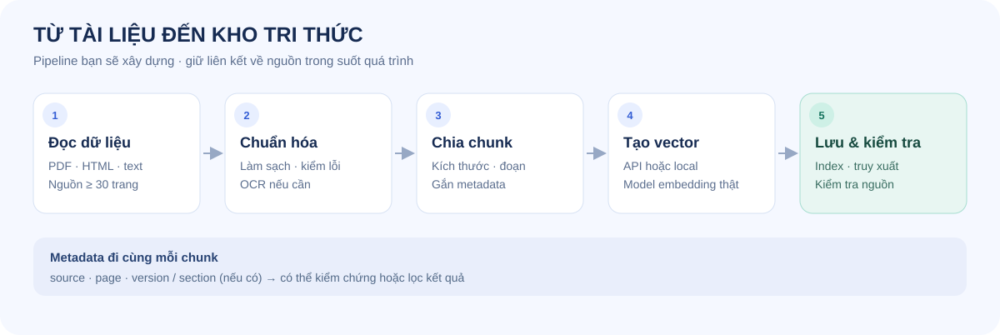
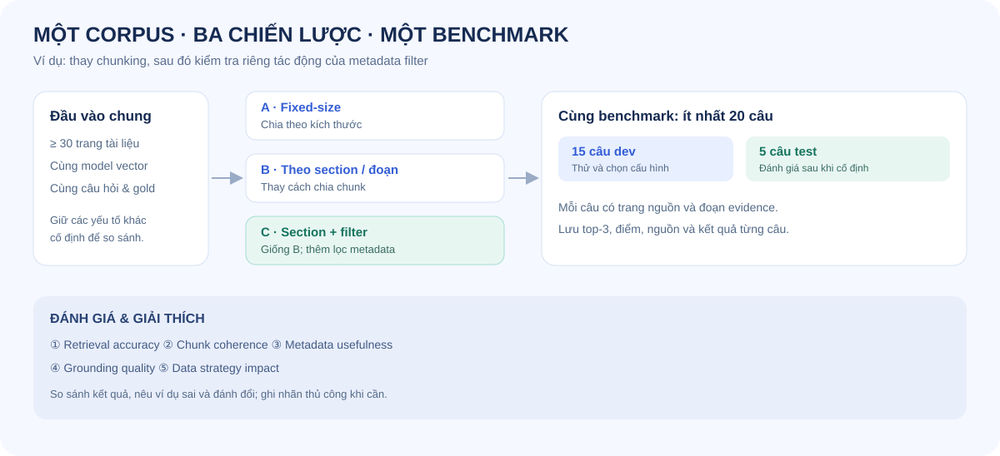

# Day 06 · Data Ingestion Engineering

**Lab cá nhân** · **4 giờ** · **Dữ liệu tự chọn**

Biến tài liệu thành kho tri thức có thể truy xuất cho AI agent, rồi đo xem cách chuẩn bị dữ liệu nào hiệu quả nhất.

| 📄 Dữ liệu | 🧩 Chiến lược | 🎯 Benchmark |
|---|---|---|
| Corpus này: **30 bài Markdown độc lập** | **3 cấu hình** A/B/C | **20 câu hỏi**, 15 dev / 5 test |

## Chạy bài đã hoàn thành (Windows PowerShell)

Pipeline dùng PostgreSQL + pgvector, đọc corpus được liệt kê trong manifest và benchmark ở `benchmark/questions.json`. Cách setup, cấu hình `.env` và chi tiết output nằm trong [starter/README.md](starter/README.md).

Từ thư mục gốc repository:

```powershell
Set-Location .\starter
docker compose -p day6_student_starter up -d --wait
& .\.venv\Scripts\python.exe -m src.run
& .\.venv\Scripts\python.exe -m src.run --split test
```

Lệnh mặc định chạy DEV; TEST phải dùng index đã tạo và cấu hình đã cố định. Chạy DEV có gọi API để tạo embedding tài liệu và câu hỏi; TEST chỉ embed câu hỏi. Các lệnh có thể phát sinh chi phí API. Nếu chỉ cần xem kết quả đã lưu, không cần chạy lại pipeline: xem [starter/results/](starter/results/) và [báo cáo cá nhân](report/individual/2A202603938_TranDucTrung.md). Không commit `starter/.env`.

Trước khi chạy lại TEST, hãy bảo quản các CSV audit đã duyệt bên ngoài `starter/results/`. TEST sẽ dừng trước API, database và thao tác ghi nếu phát hiện điểm, nhãn, lý do hoặc `review_status` hiện có. Chỉ khi đã giữ bản audit cần thiết và chủ định tạo lại kết quả, hãy chuyển các CSV audit cũ ra khỏi thư mục results; bảng chưa chấm hoặc chưa tồn tại vẫn được phép tạo.

## 1. Xây pipeline



Corpus của bài nằm ở [starter/data/corpus/](starter/data/corpus/), nguồn và attribution được ghi trong [manifest](starter/data/manifest.json). Manifest ghi ODC-BY theo khai báo của dataset MultiHopRAG; điều đó không xác nhận license hay quyền tái phân phối riêng của từng bài báo. Repo không có minh chứng quyền riêng từ từng nhà xuất bản; cần xác minh quyền áp dụng trước khi tiếp tục phân phối nội dung, đồng thời giữ nguồn và attribution phù hợp. Pipeline giữ **ID tài liệu, nguồn, đơn vị truy vết** và metadata phù hợp; dùng embedding API thật và PostgreSQL + pgvector.

## 2. So sánh và đánh giá



Dùng cùng dữ liệu, model và câu hỏi cho cả ba cấu hình. Tách **15 câu dev / 5 câu test** trước khi chạy; chọn cấu hình trên dev, rồi đánh giá test sau khi cố định. Mỗi câu hỏi cần có đoạn bằng chứng và trang nguồn; thiết kế bộ câu hỏi và đánh giá theo [BENCHMARK.md](BENCHMARK.md).

Đánh giá theo năm khía cạnh: **độ chính xác truy xuất**, **tính mạch lạc của chunk**, **tính hữu dụng của metadata**, **chất lượng grounding** và **tác động của chiến lược dữ liệu**. Giải thích lựa chọn bằng kết quả, ví dụ lỗi và các đánh đổi.

## 3. Chuẩn bị bài nộp

1. Kết quả thực nghiệm, trace top-3, cấu hình và audit đã lưu trong [starter/results/](starter/results/).
2. Thông tin học viên ở [STUDENT.md](STUDENT.md), nhật ký ở [artifacts/experiment_log.csv](artifacts/experiment_log.csv), báo cáo ở [report/individual/2A202603938_TranDucTrung.md](report/individual/2A202603938_TranDucTrung.md).
3. Đối chiếu manifest, quyền dữ liệu và checklist nộp bài trong [SUBMISSION.md](SUBMISSION.md).

## Tài liệu hướng dẫn

| Bạn cần tìm | Tài liệu |
|---|---|
| Setup baseline PostgreSQL + pgvector | [starter/README.md](starter/README.md) |
| Các bước làm và cách tính chỉ số | [GUIDE.md](GUIDE.md) |
| Tiến độ trong 4 giờ | [CHECKPOINTS.md](CHECKPOINTS.md) |
| Năm tiêu chí benchmark và bộ câu hỏi | [BENCHMARK.md](BENCHMARK.md) |
| Tiêu chí chấm điểm | [RUBRIC.md](RUBRIC.md) |
| Quy tắc sử dụng dữ liệu, AI và API | [RULES.md](RULES.md) |
| Cách nộp bài | [SUBMISSION.md](SUBMISSION.md) |

[data/format-example.json](data/format-example.json) chỉ minh họa định dạng, không phải corpus của bài. Pipeline đã hiện thực ở [starter/src/](starter/src/), benchmark ở [benchmark/questions.json](benchmark/questions.json); không bắt buộc xây chatbot.
